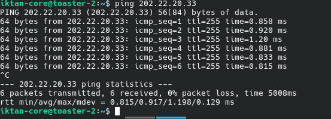

# PRÁCTICA DE LABORATORIO: IMPLEMENTACIÓN FÍSICA DE SUBNETEO IPV4
---


19/10/26

**INSTITUCIÓN**: UNIVERSIDAD TECNOLOGICA DE TABASCO 

**INTEGRANTES DEL EQUIPO**: 
- Jesus Trinidad Cruz Silva (editor)
- Angel Jesús Jiménez Estrada
- Javier Torres Castillo
- Gadi Izquierdo Pérez

**Docente**: M. en I.S. Ma. Reyna Guillermo Guillermo

---

## ÍNDICE DE CONTENIDO

* **1. INTRODUCCIÓN**
* **2. OBJETIVOS**
* **3. SUSTENTO TEÓRICO**
* **4. DESARROLLO TÉCNICO**
* **5. INTERPRETACIÓN DE RESULTADOS**
* **6. CONCLUSIONES**
* **7. BIBLIOGRAFÍA**

---

## INTRODUCCIÓN

El presente informe describe el desarrollo de la práctica de laboratorio enfocada en la segmentación de redes IPv4. El proyecto se estructuró en dos etapas principales: en primer lugar, se realizó el cálculo de subneteo a partir del bloque de red de Clase C `202.22.20.0/24`, determinando la nueva máscara de subred necesaria para obtener al menos tres subredes funcionales. En segundo lugar, se procedió a la implementación práctica sobre hardware físico, realizando la asignación de direcciones IP, el cableado correspondiente y la configuración de los dispositivos de red para validar la conectividad del entorno.

---

## OBJETIVOS

Reforzar los conceptos fundamentales de subneteo mediante el cálculo y la implementación física de un esquema de direccionamiento IPv4, documentando cada etapa del proceso en un informe técnico para validar la conectividad en un entorno de red real.

---

## SUSTENTO TEÓRICO


El direccionamiento en el protocolo IPv4 se fundamenta en un esquema de 32 bits divididos en cuatro octetos. En la arquitectura de redes tradicional por clases, las direcciones de Clase C reservan 24 bits para la identificación de la red (*Network ID*) y 8 bits para los equipos o *hosts* (*Host ID*), utilizando por defecto la máscara de red `255.255.255.0` (`/24`).

El proceso de subneteo (*subnetting*) consiste en dividir un bloque de direcciones IP en dos o más rangos independientes denominados subredes. De acuerdo con las especificaciones del RFC 1166, esta técnica permite optimizar el espacio de direccionamiento, reducir el tráfico de difusión (*broadcast*), delimitar dominios de colisión y mejorar tanto la seguridad como la administración del tráfico dentro de una infraestructura local.

Para realizar la segmentación de una red de Clase C, se aplica el principio de "préstamo de bits" (*borrowing bits*). Este método consiste en tomar $n$ bits del área correspondiente al *Host ID* (el cuarto octeto) y reasignarlos a la porción de red. La cantidad de subredes que se pueden generar se determina mediante la fórmula exponencial $2^n$, donde $n$ representa la cantidad de bits tomados prestados. 

Al modificar el prefijo de red mediante el préstamo de bits, se obtiene una nueva máscara de subred personalizada, lo que permite dividir la red original en segmentos lógicos delimitados con rangos IP específicos. Este esquema teórico constituye la base para la asignación formal de parámetros de red (dirección IP, máscara de subred y *default gateway*) en los dispositivos físicos que componen la topología.

---

## DESARROLLO TÉCNICO

### CALCULO CON EL METODO DE NUMERO MAGICO

Antes de proceder con la configuración de los equipos, se llevó a cabo el cálculo matemático del direccionamiento utilizando el **método del número mágico**. Este procedimiento permitió determinar las tres subredes requeridas a partir del bloque base de Clase C (`202.22.20.0/24`), obteniendo la nueva máscara de subred, las direcciones de red, los rangos de asignación útil para los *hosts* y sus respectivas direcciones de *broadcast*, tal como se detalla a continuación:

![[Imagen-0001.png]]
 
 #### Resumen del Esquema de Subneteo Obtenido

| Subred | Dirección de Red | Rango de IPs Utiles (Primera - Última) | Dirección de Broadcast | Máscara de Subred | Prefijo |
| :---: | :---: | :---: | :---: | :---: | :---: |
| **Sub0** | `202.22.20.0` | `202.22.20.1` – `202.22.20.30` | `202.22.20.31` | `255.255.255.224` | `/27` |
| **Sub1** | `202.22.20.32` | `202.22.20.33` – `202.22.20.62` | `202.22.20.63` | `255.255.255.224` | `/27` |
| **Sub2** | `202.22.20.64` | `202.22.20.65` – `202.22.20.94` | `202.22.20.95` | `255.255.255.224` | `/27` |
| **Sub3** | `202.22.20.96` | `202.22.20.97` – `202.22.20.126` | `202.22.20.127` | `255.255.255.224` | `/27` |
 
 
 
 
### CONFIGURACION DE EQUIPOS CISCO
 
Una vez determinados los rangos de direccionamiento, se procedió a la configuración en hardware físico de los equipos Cisco de la topología (un router y un switch de acceso).

#### Configuración de Interfaz en el Router

```cisco
Router> enable
Router# configure terminal
Router(config)# interface gigabitEthernet 0/0
Router(config-if)# ip address 202.22.20.33 255.255.255.224
Router(config-if)# no shutdown
 ```
 
 
 
> **NOTA:** Durante la configuración del router se encontraron tres comandos muy similares:
> 
> - `ip addr`
> - `ip router`
> - `ip default-gateway`
> 
> Documentamos que, durante las pruebas finales con `ping`, la conexión no daba resultado y la causa era bastante simple: aplicamos el comando `ip default-gateway` (cuya funcionalidad es definir el siguiente salto, es decir, la dirección del "vecino") en lugar de `ip address`. Además, el router ya tenía configuraciones previas que por ignorancia se pasaron por desapercibidas. Algunas pruebas en imagen:
> 
>
>

#### Configuración de Interfaz en el Swicht


```cisco
switch> enable
switch# configure terminal
switch(config)# interface vlan1
switch(config-if)# ip address 202.22.20.34 255.255.255.224
switch(config-if)# no shutdown
switch(config-if)# exit
switch(config)# ip default-gateway 202.22.20.33

```

![[WhatsApp Image 2026-10-19 at 5.48.08 PM.jpeg]]

### PING

Una vez configurados los dispositivos de red Cisco y los equipos terminales, se procedió a verificar la conectividad mediante pruebas de eco (*ping*) entre las computadoras pertenecientes a la misma subred. El resultado confirmó una comunicación exitosa y bidireccional entre los *hosts*, validando el correcto funcionamiento del esquema de direccionamiento implementado.


![[WhatsApp Image 2026-10-19 at 4.46.48 PM.jpeg]]


> **NOTA:** Se omitió la inclusión de capturas sobre la interfaz de configuración en los equipos terminales debido a la falta de evidencia fotográfica durante la sesión de laboratorio.
> 
> *_Nota del editor: Grave omisión en el registro fotográfico del despliegue (¬¬).*

---

## INTERPRETACIÓN DE RESULTADOS

Como resultado del desarrollo de la práctica, se logró la segmentación lógica y la implementación física del bloque de direcciones Clase C `202.22.20.0/24`. Los productos y hallazgos obtenidos se resumen en los siguientes puntos:

1. **Diseño de Subneteo Exitoso:** Se determinó la nueva máscara `/27` (`255.255.255.224`), generando cuatro subredes útiles con un tamaño de bloque de 32 direcciones cada una, cumpliendo con la cantidad de subredes requeridas y optimizando el espacio de direccionamiento.
2. **Despliegue y Configuración de Hardware:** Se estableció la comunicación local al aplicar las direcciones correspondientes en el router (interfaz de puerta de enlace), en el switch de acceso (interfaz VLAN1 de gestión) y en los equipos terminales.
3. **Validación de Conectividad:** Las pruebas de eco (*ping*) confirmaron la transmisión bidireccional de paquetes entre los *hosts* pertenecientes a un mismo segmento, ratificando el aislamiento entre subredes y el funcionamiento correcto de la infraestructura física desplegada.

---

## CONCLUSIONES

En conclusión, el desarrollo de esta práctica permitió consolidar los conocimientos teóricos del subneteo IPv4 mediante su aplicación práctica en un entorno de red real y simulado. Los resultados concretos obtenidos demuestran que:

1. **Eficiencia en el direccionamiento:** A partir del bloque de Clase C `202.22.20.0/24`, se calculó e implementó con éxito la máscara de subred `/27`, logrando segmentar la red en los bloques requeridos para optimizar el tráfico de datos.
2. **Dominio de la configuración de hardware:** Se configuraron correctamente los dispositivos activos de red (router y switch Cisco) así como los equipos terminales, superando las incidencias técnicas iniciales asociadas a los comandos de gestión y parámetros residuales.
3. **Validación de la conectividad:** Las pruebas de comunicación mediante el comando *ping* comprobaron el enlace exitoso dentro de los segmentos establecidos, cumpliendo plenamente con el objetivo de reforzar las competencias en infraestructura de red, fundamentales para el diseño seguro de arquitecturas y la futura especialización en ciberseguridad.

---

## BIBLIOGRAFÍA

Coordinación de Universidad Abierta y Educación a Distancia. (s. f.). *Subneteo o subnet*. Unidad de Apoyo para el Aprendizaje (UAPA), Licenciatura en Informática. Universidad Nacional Autónoma de México. https://repositorio-uapa.cuaed.unam.mx/repositorio/moodle/pluginfile.php/823/mod_resource/content/7/contenido/index.html

---

## ANEXOS

![[WhatsApp Image 2026-10-19 at 4.51.37 PM.jpeg]]

![[WhatsApp Image 2026-10-19 at 4.51.38 PM.jpeg]]
